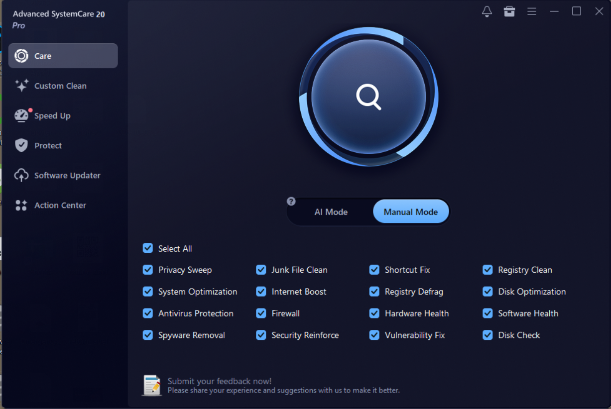
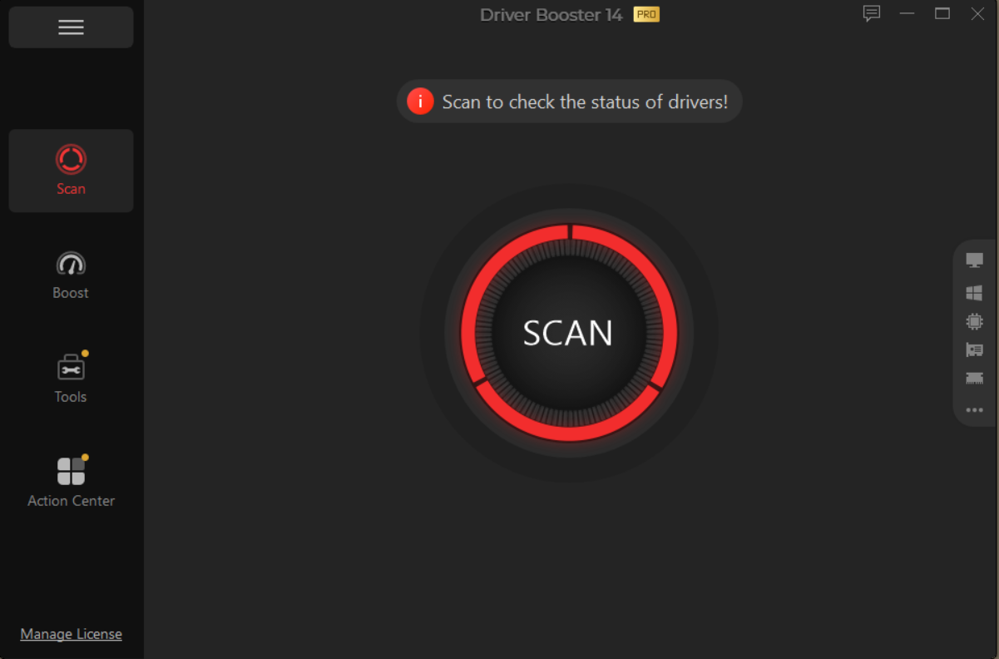
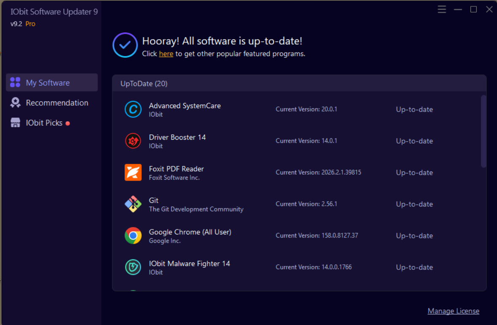
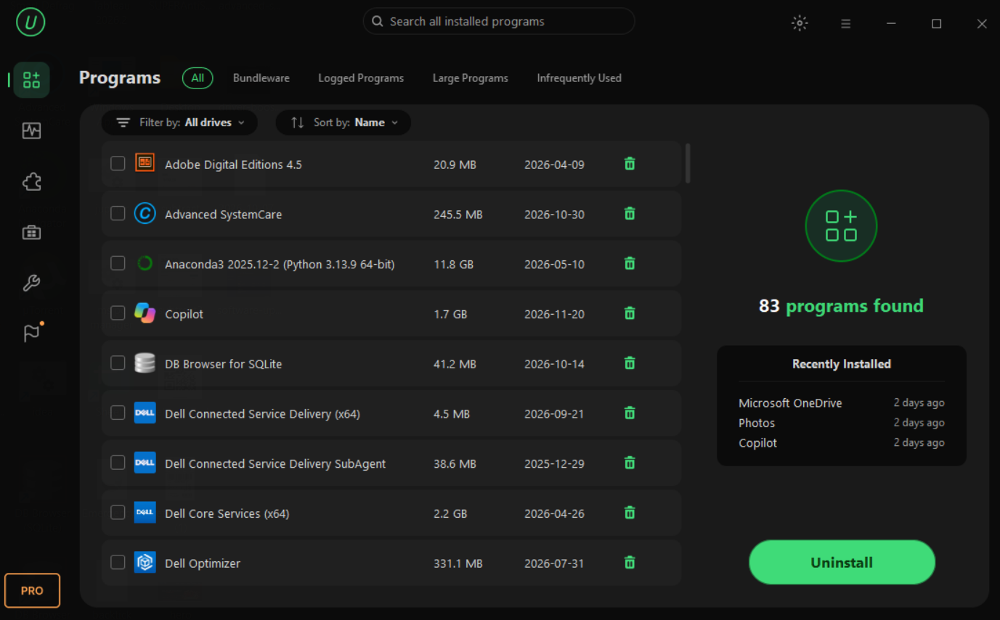
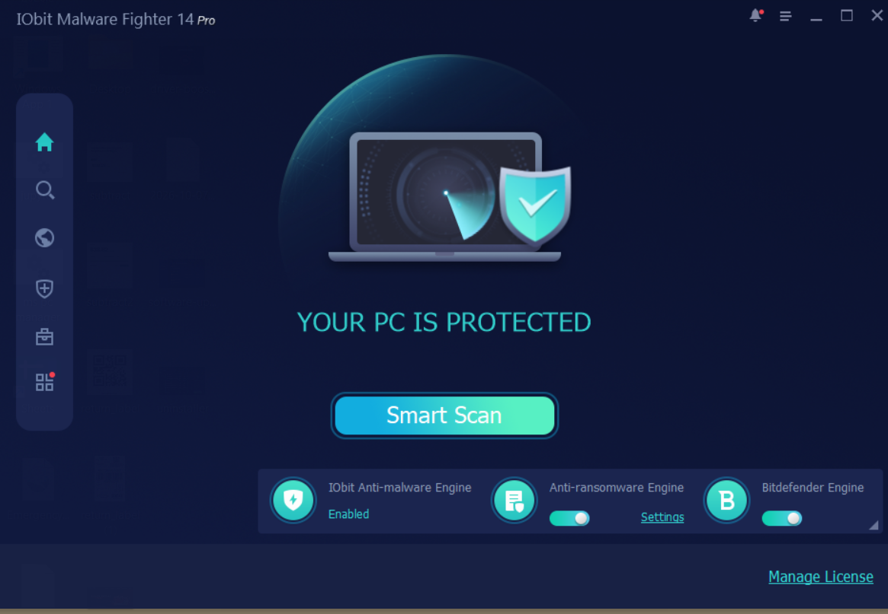
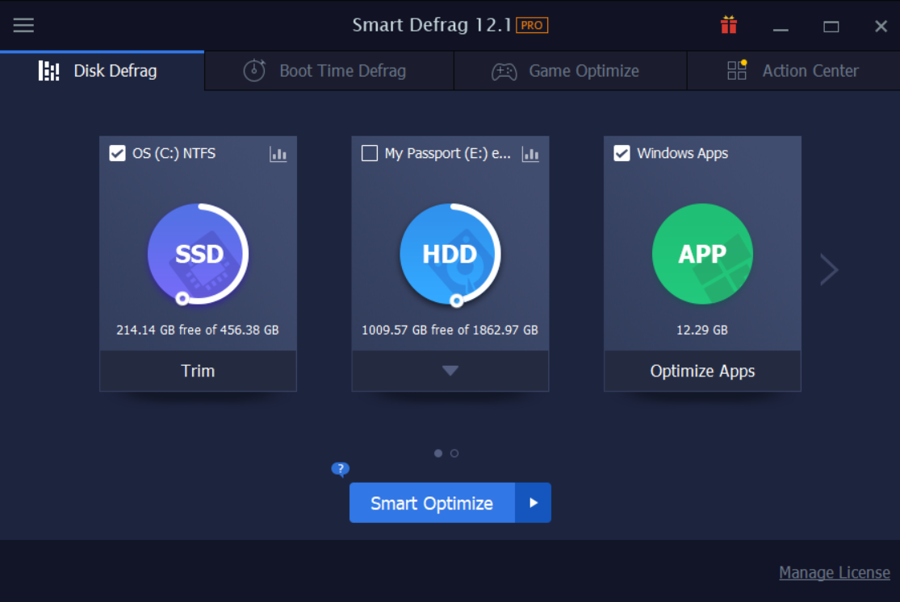

A computer needs more than an operating system and a "set it and forget it" attitude. Over time, junk files pile up, drivers fall behind, apps go out of date, and leftover programs eat disk space.

I tried IObit's maintenance tools to see how much of that they could handle in one place. Here's what each one does, what it looked like on my PC, and who it's best for.

## Quick Overview

| Tool | What it does | Best for |
|---|---|---|
| Advanced SystemCare | Cleanup and optimization | General tune-ups |
| Driver Booster | Driver updates | Hardware stability |
| Software Updater | App updates | Security and compatibility |
| Uninstaller | Deep program removal | Clearing leftovers |
| Malware Fighter | Threat detection | Extra protection |
| Smart Defrag | HDD optimization | Older hard drives |

## Advanced SystemCare

Advanced SystemCare is the all-rounder. It cleans unnecessary files, tweaks system settings, and runs security-related scans to help spot potential threats.

## Driver Booster

Instead of hunting down updates for each hardware component by hand, Driver Booster scans your PC for outdated drivers and helps you update them. Current drivers support better hardware compatibility and system stability.

**My experience:** [e.g., "It flagged X outdated drivers, including audio and graphics."]

> **Tip:** Create a Windows restore point before installing driver updates, just in case something doesn't play nicely.

## IObit Software Updater

Software Updater checks your installed applications for new versions and makes updating easier. Updates matter for new features, but also for security and compatibility.

## IObit Uninstaller

The standard Windows uninstall often leaves files and other remnants behind. IObit Uninstaller goes further by helping remove those leftovers along with the program itself.

## IObit Malware Fighter

Malware Fighter is built to detect and remove viruses, spyware, and other harmful software. It also uses the Bitdefender engine for additional threat detection.

**My experience:** [e.g., "A full scan took about X minutes and found ___."]

## Smart Defrag

Smart Defrag optimizes disk performance through defragmentation. On a traditional hard disk drive (HDD), this can organize fragmented data and improve file-access efficiency.

> **Important:** SSDs use different optimization methods and should not be treated like HDDs. If your PC has an SSD, you generally don't need to defragment it.

## What I Liked and What to Watch For

**What I liked**

- Everything lives in one ecosystem, so there's less app-hopping
- Scans are quick and easy to understand
  

**What to watch for**

- Some features require a paid upgrade
- Review what's selected before applying any cleanup
- Make a restore point before updating drivers

## Which Tools Do You Need?

You don't have to install all six.

- **Just the basics:** Start with Advanced SystemCare and Driver Booster.
- **Keeping apps secure:** Add Software Updater.
- **Messy old PC:** Add Uninstaller.
- **Extra protection:** Add Malware Fighter.
- **Older HDD:** Add Smart Defrag.

## A Complete Set of Maintenance Tools

Together, these tools cover the main areas of PC upkeep: cleaning and optimization, driver updates, software management, malware protection, and disk optimization. If you'd rather have your maintenance tools under one roof, IObit's collection is a convenient way to keep a Windows PC organized.

**Want to try them?** [Download the free versions and see for yourself](https://www.iobit.com/).
